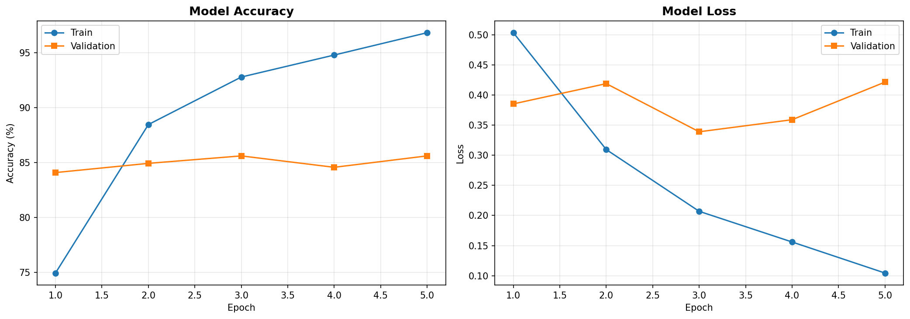
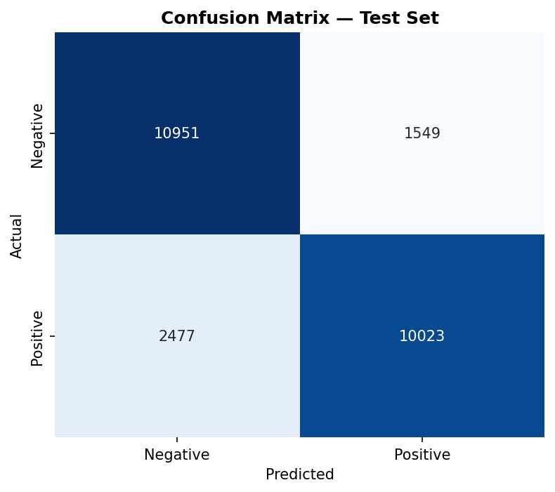

# Sentiment Analysis with Bidirectional LSTM

[](https://github.com/Tariq-Mehdawi/sentiment-analysis-lstm/actions/workflows/ci.yml)

A deep learning sentiment classifier built from scratch in TensorFlow/Keras, trained on the Stanford IMDB Movie Reviews dataset. The model learns its own word representations via a trainable embedding layer and reads reviews sequentially with a bidirectional LSTM, allowing it to capture context and negation that bag-of-words approaches miss.

**Test accuracy: 83.90% | ROC-AUC: 92.16%** on 25,000 held-out reviews.

The model is served as a tested, containerised **FastAPI** service, built, scanned and published automatically by **GitHub Actions**.

---

## 🚀 Run the service (one command)

```bash
docker run -p 8000:8000 ghcr.io/tariq-mehdawi/sentiment-analysis-lstm:latest
```

Then open **http://localhost:8000/docs** for the interactive API, or:

```bash
curl http://localhost:8000/health

curl -X POST http://localhost:8000/predict \
  -H "Content-Type: application/json" \
  -d '{"text": "This movie completely blew me away, brilliant acting."}'
```

**Pinned image (reproducible):**
`ghcr.io/tariq-mehdawi/sentiment-analysis-lstm@sha256:f2c5d788425a5c964b6be871a0f783a1ac42b8b12022c0aac385081410c72702`

## 🛠️ MLOps pipeline

| Part | What it does |
|---|---|
| `src/app/main.py` | FastAPI service: `GET /health`, `POST /predict` with pydantic input validation |
| `src/train/train.py` | Training script (`python -m src.train.train`) |
| `tests/` | 11 pytest tests: API contract, model loading, input schema, edge cases, determinism |
| `Dockerfile` | Multi-stage, non-root, pinned base image (by digest), `HEALTHCHECK` |
| `.github/workflows/ci.yml` | Lint + test on every PR; on `main`: build → Trivy scan → push to GHCR tagged with the commit SHA. All actions pinned to full commit SHAs |
| Branch protection | `main` requires a PR and a passing **Lint & Test** check |

### Run tests locally
```bash
uv venv --python 3.12 .venv && source .venv/bin/activate
uv pip install -r requirements-dev.txt
ruff check src tests && pytest -v
```

---

## Table of Contents

- [Motivation](#motivation)
- [Dataset](#dataset)
- [Tech Stack](#tech-stack)
- [Project Structure](#project-structure)
- [Model Architecture](#model-architecture)
- [Results](#results)
- [Error Analysis](#error-analysis)
- [Installation](#installation)
- [Usage](#usage)
- [Key Design Decisions](#key-design-decisions)
- [Limitations & Future Work](#limitations--future-work)
- [License](#license)

---

## Motivation

Classical bag-of-words methods (TF-IDF + linear classifiers) treat text as an unordered collection of tokens. This makes them structurally incapable of distinguishing *"not good"* from *"good"* — the words are identical, only the order differs.

This project implements a sequential deep learning alternative to test that limitation directly. The embedding layer learns dense word representations from the training corpus rather than relying on hand-engineered features, and the bidirectional LSTM processes reviews token by token in both directions, maintaining a hidden state that carries context forward.

---

## Dataset

[Stanford Large Movie Review Dataset (aclImdb v1)](https://ai.stanford.edu/~amaas/data/sentiment/)

| Split | Reviews | Positive | Negative |
|---|---|---|---|
| Train | 22,500 | 11,250 | 11,250 |
| Validation | 2,500 | 1,250 | 1,250 |
| Test | 25,000 | 12,500 | 12,500 |

The dataset ships with a fixed 25,000/25,000 train/test split, which is preserved here so results remain comparable to published benchmarks. The validation set is carved from the training portion via a stratified 90/10 split. An additional 50,000 unlabeled reviews included in the archive are unused, as this is a supervised task.

Class balance is exactly 50/50 in every split, so accuracy is a meaningful headline metric.

---

## Tech Stack

| Component | Technology |
|---|---|
| Language | Python 3.12 |
| Deep Learning | TensorFlow 2.21 / Keras 3.15 |
| Data Handling | pandas, NumPy |
| Evaluation | scikit-learn |
| Visualization | matplotlib, seaborn |
| Serving | FastAPI, Uvicorn, pydantic |
| Testing & Lint | pytest, ruff |
| Containerisation | Docker (multi-stage, non-root) |
| CI/CD | GitHub Actions, Trivy, GitHub Container Registry |
| Training Environment | Google Colab (T4 GPU) |

---

## Project Structure

```
sentiment-analysis-lstm/
├── .github/workflows/
│   └── ci.yml                   # lint, test, build, scan, push
├── data/
│   ├── raw/                     # downloaded dataset (gitignored)
│   └── processed/               # cached CSVs (gitignored)
├── models/
│   ├── sentiment_lstm_model.keras
│   ├── tokenizer.pkl
│   └── config.json
├── notebooks/
│   └── sentiment_analysis_lstm.ipynb
├── outputs/
│   └── plots/
│       ├── training_curves.png
│       └── confusion_matrix.png
├── src/
│   ├── app/
│   │   └── main.py              # FastAPI service
│   ├── train/
│   │   └── train.py             # training loop + callbacks
│   ├── data_loader.py           # download + parse the dataset
│   ├── preprocess.py            # cleaning, tokenization, padding
│   ├── model.py                 # architecture definition
│   ├── evaluate.py              # metrics + plots
│   └── predict.py               # inference on new text
├── tests/
│   ├── conftest.py
│   └── test_api.py
├── Dockerfile
├── .dockerignore
├── requirements.txt             # serving dependencies (pinned)
├── requirements-train.txt       # + training/evaluation extras
├── requirements-dev.txt         # + pytest, ruff
├── pytest.ini
├── LICENSE
└── README.md
```

---

## Model Architecture

```
Input (200 tokens)
      │
      ▼
Embedding (10,000 vocab → 128 dims)          1,280,000 params
      │
      ▼
Bidirectional LSTM (64 units each direction)    98,816 params
      │
      ▼
Dropout (0.5)
      │
      ▼
Dense (32, ReLU)                                 4,128 params
      │
      ▼
Dropout (0.5)
      │
      ▼
Dense (1, sigmoid)                                  33 params
      │
      ▼
P(positive) ∈ [0, 1]
```

**Total trainable parameters: 1,382,977** — 93% of which sit in the embedding layer, meaning most of what this model learns is word semantics.

**Hyperparameters**

| Parameter | Value |
|---|---|
| Vocabulary size | 10,000 |
| Sequence length | 200 tokens (post-padded, post-truncated) |
| Embedding dimension | 128 |
| LSTM units | 64 per direction |
| Dropout rate | 0.5 |
| Optimizer | Adam (lr = 1e-3) |
| Loss | Binary cross-entropy |
| Batch size | 64 |
| Max epochs | 10 (early stopping triggered at 5) |

**Training callbacks**

- `EarlyStopping` — monitors validation loss, patience 2, restores best weights
- `ModelCheckpoint` — saves the best model by validation loss
- `ReduceLROnPlateau` — halves the learning rate when validation loss plateaus

All three monitor the same metric (`val_loss`) so the restored, checkpointed, and reported model are guaranteed identical.

---

## Results

### Training

Training ran 5 epochs before early stopping; the best weights came from **epoch 3**.

| Epoch | Train Acc | Val Acc | Train Loss | Val Loss |
|---|---|---|---|---|
| 1 | 74.92% | 84.08% | 0.5034 | 0.3852 |
| 2 | 88.46% | 84.92% | 0.3094 | 0.4189 |
| **3** | **92.79%** | **85.60%** | **0.2069** | **0.3389** |
| 4 | 94.79% | 84.56% | 0.1560 | 0.3590 |
| 5 | 96.83% | 85.60% | 0.1044 | 0.4214 |



Validation loss reaches its minimum at epoch 3 and rises afterward while training loss continues to fall — the classic overfitting signature. Early stopping restored weights from that minimum.

Note that validation accuracy exceeds training accuracy at epoch 1. This is expected: dropout is active during training but disabled at validation, so the model has its full capacity available when validating.

### Test Set (25,000 unseen reviews)

| Metric | Score |
|---|---|
| Accuracy | **83.90%** |
| Loss | 0.3788 |
| ROC-AUC | **92.16%** |

| Class | Precision | Recall | F1 | Support |
|---|---|---|---|---|
| Negative | 0.8155 | 0.8761 | 0.8447 | 12,500 |
| Positive | 0.8661 | 0.8018 | 0.8328 | 12,500 |
| **Macro avg** | **0.8408** | **0.8390** | **0.8387** | 25,000 |



The 1.7-point gap between validation (85.60%) and test (83.90%) accuracy is expected — validation influenced stopping and learning-rate decisions, so it is mildly optimistic. The test set influenced nothing and is the honest figure.

ROC-AUC (92.16%) meaningfully exceeds accuracy (83.90%), indicating the model ranks reviews by sentiment better than the fixed 0.5 decision threshold suggests. Threshold tuning is a likely source of easy gains.

---

## Error Analysis

The model shows a **systematic bias toward predicting Negative**:

- Positive reviews misclassified as negative: **2,477**
- Negative reviews misclassified as positive: **1,549**

Positive recall (80.18%) trails negative recall (87.61%) by over 7 points. A plausible explanation: negative reviews rely on explicit, unambiguous vocabulary ("terrible", "boring", "waste"), while positive reviews more often use restrained praise and frequently mix in criticism.

### Custom sentence evaluation

| Sentence | Predicted | Score | Correct |
|---|---|---|---|
| "This movie was absolutely fantastic! Best film I've seen all year." | POSITIVE | 96.50% | ✅ |
| "Terrible acting, boring plot. Complete waste of time." | NEGATIVE | 0.24% | ✅ |
| "The cinematography was stunning and the soundtrack was beautiful." | POSITIVE | 74.65% | ✅ |
| "I fell asleep halfway through. Nothing happens." | NEGATIVE | 5.27% | ✅ |
| "This movie was not good at all." | NEGATIVE | 47.30% | ⚠️ |
| "It wasn't bad, actually I enjoyed it more than I expected." | POSITIVE | 70.07% | ✅ |
| "The film had some issues with pacing, but the performances were incredible." | NEGATIVE | 46.77% | ❌ |

Three observations worth highlighting:

**Implicit sentiment is handled well.** *"I fell asleep halfway through. Nothing happens."* contains no negative sentiment vocabulary, yet scores 5.27%. The model inferred negativity from context rather than keyword matching.

**Negation is captured but weakly.** *"This movie was not good at all"* is classified correctly at 47.30% — the negation registered (otherwise "good" would dominate), but only barely overcame it. Double negation in *"It wasn't bad, actually I enjoyed it"* was resolved more confidently at 70.07%.

**Contrastive constructions are the main failure mode.** *"...issues with pacing, but the performances were incredible"* is misclassified. The negative first clause outweighs the positive conclusion, consistent with the low positive recall above. Correctly weighting post-"but" clauses is a known weakness of models without attention mechanisms.

---

## Installation

```bash
git clone https://github.com/Tariq-Mehdawi/sentiment-analysis-lstm.git
cd sentiment-analysis-lstm
pip install -r requirements-train.txt
```

---

## Usage

Run all commands from the project root.

**Download and prepare the data**
```bash
python -m src.data_loader
```

**Train the model**
```bash
python -m src.train.train
```

**Evaluate on the test set**
```bash
python -m src.evaluate
```

**Predict on your own text**
```bash
python -m src.predict "This movie completely blew me away."
```

Or from Python:
```python
from src.predict import SentimentPredictor

predictor = SentimentPredictor(model_dir='models')
result = predictor.predict("The plot was predictable but the acting saved it.")

print(f"{result['label']} ({result['confidence']*100:.2f}%)")
```

---

## Key Design Decisions

**Raw text over Keras's pre-encoded IMDB dataset.** `tf.keras.datasets.imdb` ships pre-tokenized integer sequences. Using the raw text version means tokenization, vocabulary construction, and padding are implemented explicitly rather than inherited.

**No stopword removal.** Standard for TF-IDF pipelines, but harmful here — most stopword lists strip negation words ("not", "no", "didn't"), which are critical signal for sentiment. Sequential models need them intact.

**Tokenizer fit on training data only.** Building the vocabulary from validation or test text would leak information about the evaluation set into the model, inflating reported performance.

**Preserved the official train/test split.** Reshuffling into a custom 80/20 split would produce results incomparable to published IMDB benchmarks.

**All callbacks monitor `val_loss`.** An earlier version monitored `val_accuracy` for checkpointing and `val_loss` for early stopping, causing the saved model on disk to differ from the model restored in memory.

**Pinned serving dependencies.** The model and pickled tokenizer only load reliably with a matching Keras version, so `requirements.txt` pins exact versions. When Trivy flagged HIGH CVEs in Keras 3.13.2, the version was bumped to 3.15.0 and the test suite confirmed the saved artifacts still load and predict correctly.

---

## Limitations & Future Work

**Current limitations**

- Contrastive sentiment ("X was bad, but Y was great") is unreliable
- 10,000-word vocabulary discards rare but informative terms
- 200-token truncation cuts the ending of longer reviews, where conclusions often live
- Trained on movie reviews only; domain transfer to other text is untested
- ~7-point train/validation gap indicates residual overfitting

**Planned improvements**

| Improvement | Expected benefit |
|---|---|
| Pretrained GloVe embeddings | Semantic knowledge from billions of words instead of 22.5k reviews |
| Attention mechanism | Explicit weighting of decisive clauses; addresses the "but" failure mode |
| Threshold tuning | ROC-AUC of 92.16% suggests headroom above the 0.5 default |
| Fine-tuned DistilBERT | Transformer baselines typically reach 92–94% on IMDB |
| Stacked / deeper LSTM layers | Higher-level sequence abstraction |

---

## License

MIT — see [LICENSE](LICENSE).

---

## Acknowledgments

Dataset: Maas, A. L., Daly, R. E., Pham, P. T., Huang, D., Ng, A. Y., & Potts, C. (2011). *Learning Word Vectors for Sentiment Analysis*. ACL 2011.